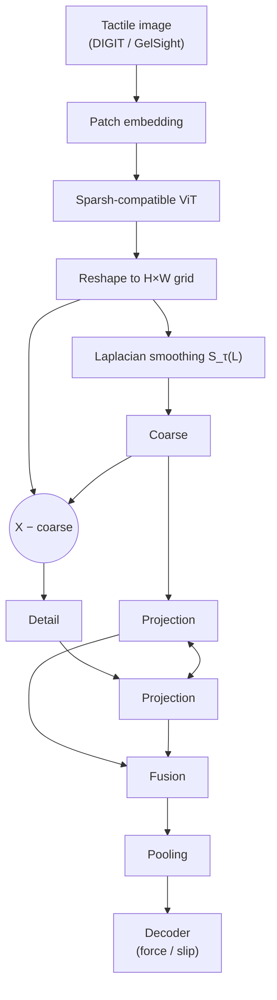

# Laplacian-Based Tactile Representation Learning and World Modeling

**Semester project** at the Sensing, Interaction & Perception Lab (SIPLab) (ETH Zürich)

**Student:** Baudoin Coispeau
**Supervision:** Berken Utku Demirel and Prof. Dr. Christian Holz

> 🚧 **Status:** work in progress. See the [roadmap](#roadmap) for current progress.

---

## Overview

This project asks whether **explicitly separating coarse spatial structure from local detail** improves self-supervised tactile representations.

Patch features from a Vision Transformer are arranged on their original 2D grid, connected into a **graph Laplacian**, and split into:

- a **coarse** component (Laplacian-based smoothing), and
- a **detail** component (the residual).

These components are integrated into a **Sparsh-compatible ViT**, trained with a **JEPA-style** self-supervised objective, and evaluated with frozen encoders on **TacBench** force estimation and slip detection.

If the representation shows consistent gains over matched baselines, the project extends to **action-conditioned tactile world modeling**: predicting how contact evolves under robot actions.

## Motivation

Vision-based tactile sensors (DIGIT, GelSight) capture contact at multiple spatial and temporal scales:

- **Three-axis force estimation** may depend on broad deformation patterns across the elastomer.
- **Slip detection** may depend on localized spatial changes and short-term temporal information.

Recent systems such as Sparsh show that ViTs pretrained with I-JEPA or DINO on unlabeled tactile data transfer well to these tasks. This project tests whether making the 2D neighborhood structure of patches explicit, and representing scales separately, helps the model capture contact-relevant information.

The experiments do **not** assume that force and slip map exclusively to different frequency bands. They test empirically what each component captures.

## Method

### 1. Patch grid as a graph

Let $`X \in \mathbb{R}^{N \times C}`$ be the patch features, with $`N = H \times W`$ patches arranged on their original grid. Neighboring patches are connected by an adjacency matrix $`A`$, with degree matrix $`D`$ and graph Laplacian

```math
L = D - A.
```

### 2. Coarse / detail decomposition

```math
X_{\text{coarse}} = S_\tau(L)\,X, \qquad X_{\text{detail}} = X - X_{\text{coarse}}
```

where $`S_\tau(L)`$ is a Laplacian smoothing operator with scale $`\tau`$ (e.g. iterated smoothing $`(I - \tau L)^k`$ or the heat kernel $`e^{-\tau L}`$). By construction, $`X_{\text{coarse}} + X_{\text{detail}} = X`$, which is verified as a unit test.

### 3. Fusion and integration

Both components are projected into the model's embedding space and combined before downstream pooling, with a pathway that lets information pass between them. The module reuses compatible layers from a released Sparsh checkpoint, and all comparisons are kept approximately matched in **parameter count, token count, and compute**.



For slip, frame pairs or short tactile clips are also evaluated wherever suitable sequences are available.

### 4. JEPA-style self-supervised pretraining

The model predicts masked target representations from visible context, following the Sparsh training pipeline. **Masks are applied before context encoding and spatial aggregation**, so no information from target patches can leak into the context through the graph.

Depending on compute, one of three training regimes is used:

| Regime | Trained | Frozen |
|---|---|---|
| Lightweight | Laplacian modules | Pretrained backbone |
| Partial | Laplacian modules + selected backbone layers | Remaining layers |
| Full | Complete backbone | — |

The baseline and the Laplacian model share the same training data, augmentations, optimization budget, and comparable capacity.

## Datasets

| Stage | Data |
|---|---|
| Pretraining | Existing tactile datasets used by Sparsh |
| Downstream evaluation | TacBench force estimation and slip detection (DIGIT and GelSight) |
| Temporal experiments | Existing tactile sequences with frame ordering and sequence boundaries |
| World model (later) | Synchronized tactile observations, robot states, and actions, collected in the lab |

## Evaluation protocol

- **Baseline:** a released Sparsh ViT. The first step is reproducing its TacBench force and slip results.
- **Splits:** fixed train/validation/test splits. Frames from the same recording always stay in the same split to avoid leakage.
- **Probing:** frozen encoder + lightweight decoders; partial or full fine-tuning where feasible.
- **Metrics:**
  - Force: RMSE per axis ($`F_x`$, $`F_y`$, $`F_z`$) and the mean across axes
  - Slip: F1, precision, recall
- **Robustness:** multiple training seeds; model selection on validation data only.
- **Reference points:** standard Sparsh features and a randomly initialized encoder.

## Ablations

| Question | Variants |
|---|---|
| Does Laplacian processing help? | Standard Sparsh features vs. Laplacian processing |
| Which component matters? | Coarse only · Detail only · Coarse + Detail |
| Does time matter? | Spatial-only vs. spatiotemporal processing |
| Which scale? | Different smoothing scales $`\tau`$ |
| Is it the Laplacian or just extra spatial mixing? | Laplacian vs. matched convolutional or Grid-GNN processing |
| Graph vs. image pyramid? | Graph Laplacian vs. image Laplacian pyramid (where feasible) |

The analysis separates gains due to the spatial decomposition from gains due to additional parameters or training.

## Tactile world modeling (stretch goal)

Pursued **only if** the representation experiments show consistent benefits.

- **Data:** a pilot dataset from a DIGIT (or similar) sensor mounted on a robot, with synchronized tactile observations, robot states, and actions. Initial interactions: pressing, holding, sliding, releasing.
- **Model:** a lightweight dynamics model that takes a short history of tactile features plus robot state and action, and predicts future coarse and detail features, with information exchange between the two.
- **Setup:** frozen tactile encoder; Laplacian features vs. standard Sparsh features under the same dynamics model and training budget.
- **Evaluation:**
  - prediction accuracy over increasing horizons
  - future force-estimation error
  - prediction of slip onset and contact loss
  - effect of removing or shuffling action inputs

Using predicted contact outcomes for action selection is a further extension, depending on time and results.

## Roadmap

- [ ] **M1 · Literature review and baseline setup** (week 1)
  - [ ] Review Sparsh, I-JEPA, V-JEPA, Wave-ViT and related tactile SSL work
  - [ ] Study Laplacian filtering and grid-based spatial aggregation
  - [ ] Set up the Sparsh training and evaluation pipeline
- [ ] **M2 · Laplacian architecture** (weeks 1–2)
  - [ ] Graph construction and Laplacian filtering in PyTorch
  - [ ] Verify coarse + detail reconstructs the original features
  - [ ] Integrate into the ViT backbone
  - [ ] Check masking behavior and computational overhead
- [ ] **M3 · Self-supervised training** (weeks 2–5)
  - [ ] Train the Laplacian representation model
  - [ ] Run matched baseline experiments
  - [ ] Monitor training stability and representation quality
  - [ ] Compare lightweight adaptation vs. partial backbone training
- [ ] **M4 · Downstream evaluation** (weeks 5–7)
  - [ ] Frozen decoders for force estimation and slip detection
  - [ ] Force RMSE and slip F1 / precision / recall
  - [ ] Partial or full fine-tuning where feasible
  - [ ] Compare against standard Sparsh and random-init baselines
  - [ ] Decide whether results justify new data collection
- [ ] **M5 · Ablations and analysis** (weeks 7–9)
  - [ ] Coarse / detail components separately and jointly
  - [ ] Spatial vs. temporal variants
  - [ ] Matched spatial-processing controls
  - [ ] Inference speed, parameter count, compute cost
- [ ] **Stretch · Data collection and world modeling** (weeks 9–10)
  - [ ] Connect a DIGIT (or similar) sensor to the robot setup
  - [ ] Collect a pilot synchronized dataset
  - [ ] Train an action-conditioned predictor on frozen features
  - [ ] Compare against a Sparsh-based predictor
- [ ] **M6 · Writing and presentation** (weeks 1–11)
  - [ ] Literature notes and experiment log, kept throughout
  - [ ] Methods and related-work chapters during implementation
  - [ ] Final report and presentation

## Acknowledgements

This project is carried out at the Sensing, Interaction & Perception Lab, ETH Zürich, under the supervision of Berken Utku Demirel and Prof. Dr. Christian Holz. It builds on the open-source [Sparsh](https://github.com/facebookresearch/sparsh) codebase and models.
